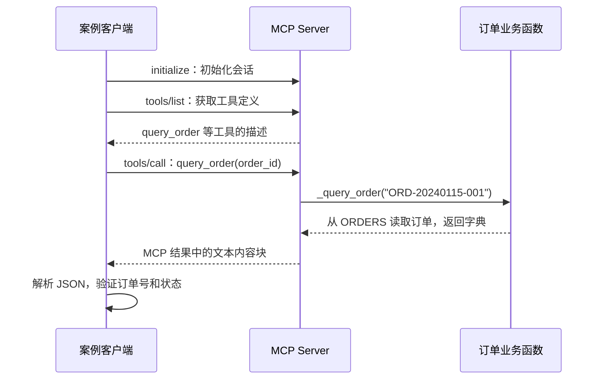

# 第4期：用订单查询案例理解 MCP 集成

本节使用项目已有的订单 `ORD-20240115-001`，走通“发现工具 → 调用工具 → 获取订单结果”的完整过程，再解释大模型如何参与。

这里的订单数据来自 `src/mini_ecom_agent/tools/mock_data.py`，是模拟数据；客户端与服务端之间的 MCP 通信和工具执行是真实的。

## 1. 什么才算真正使用了 MCP 工具？

下面三个动作需要分清：

| 动作 | 做了什么 | 是否执行订单查询 |
| --- | --- | --- |
| `@mcp.tool()` | 在服务端注册工具，并由 SDK 生成工具描述 | 否 |
| `session.list_tools()` | 客户端获取工具名、说明、参数 Schema | 否 |
| `session.call_tool("query_order", ...)` | 客户端请求服务端执行工具，取得结果 | 是 |

因此，运行 `test/test_converter.py --live` 并看到“转换前：MCP Tool 原始对象（4 个）”，只证明工具发现成功。该脚本没有调用订单查询工具。

## 2. 服务端如何提供订单查询工具

对应文件：[mcp_server/server.py](../mcp_server/server.py)。

```python
from mcp.server.mcpserver import MCPServer
from mini_ecom_agent.tools.order import query_order as _query_order
import json

mcp = MCPServer("ecom-tools")

@mcp.tool()
def query_order(order_id: str):
    """根据订单号查询订单详情，包括订单状态、商品信息、金额、物流单号等"""
    result = _query_order(order_id)
    return json.dumps(result, ensure_ascii=False)
```

这是已有服务端代码的节选，不需要再创建一份服务端。

SDK 根据函数名、文档字符串、参数名称和类型注解生成工具定义。`order_id` 没有默认值，因此属于必填参数：

```json
{
  "name": "query_order",
  "description": "根据订单号查询订单详情，包括订单状态、商品信息、金额、物流单号等",
  "inputSchema": {
    "properties": {
      "order_id": {
        "title": "Order Id",
        "type": "string"
      }
    },
    "required": ["order_id"],
    "type": "object",
    "title": "query_orderArguments"
  }
}
```

收到调用请求后，服务端才执行函数体中的 `_query_order(order_id)`。业务函数在 [order.py](../src/mini_ecom_agent/tools/order.py) 中：

```python
def query_order(order_id: str) -> dict:
    order = ORDERS.get(order_id)
    if not order:
        return {"success": False, "error": f"未找到订单 {order_id}，请核实订单号"}
    return {"success": True, "order": order}
```

这个函数从 `ORDERS` 字典读取数据。MCP 负责传递调用请求和结果，具体如何查询订单仍然由业务函数负责。

## 3. 可运行案例：通过 MCP 实际查询一次订单

先直接使用项目安装的 MCP SDK，避免把模型配置和协议调用混在一起。这个案例不需要模型 API Key，也不会调用模型。

### 第一步：启动 MCP Server

在项目根目录打开终端 A，执行：

```powershell
uv sync
uv run python mcp_server/server.py
```

保持终端 A 运行。已有服务端使用 Streamable HTTP，地址为：

```text
http://127.0.0.1:9123/mcp
```

### 第二步：发现并调用工具

在项目根目录另开 PowerShell 终端 B，完整粘贴以下命令。它通过标准输入运行 Python，不需要额外保存脚本：

```powershell
$OutputEncoding = [Console]::OutputEncoding = [System.Text.UTF8Encoding]::new()
@'
import asyncio
import json
import sys

from mcp import ClientSession
from mcp.client.streamable_http import streamable_http_client

sys.stdout.reconfigure(encoding="utf-8")

async def main():
    async with streamable_http_client("http://127.0.0.1:9123/mcp") as (read, write):
        async with ClientSession(read, write) as session:
            # 1. 初始化 MCP 会话。
            await session.initialize()

            # 2. 发现工具，此时还没有执行订单查询。
            tools = await session.list_tools()
            names = [tool.name for tool in tools.tools]
            print("服务端提供的工具：", names)
            assert "query_order" in names

            # 3. 真正发送工具执行请求。
            result = await session.call_tool(
                "query_order",
                {"order_id": "ORD-20240115-001"},
            )

            # 4. MCP 返回的是内容块，取出其中的文本。
            text = "\n".join(
                item.text
                for item in result.content
                if getattr(item, "type", None) == "text"
            )
            if result.is_error:
                raise RuntimeError(f"MCP 工具执行失败：{text}")

            # 5. 当前服务端将业务结果序列化为 JSON 字符串。
            data = json.loads(text)
            assert data["success"] is True, data
            assert data["order"]["order_id"] == "ORD-20240115-001"
            assert data["order"]["status"] == "shipped"
            print(json.dumps(data, ensure_ascii=False, indent=2))
            print("验证通过：已通过 MCP 获取订单结果。")

asyncio.run(main())
'@ | uv run python -
```

此处 `(read, write)` 和 `result.is_error` 的写法对应本项目当前安装的 SDK，与项目中的客户端代码保持一致。

### 第三步：检查结果

按当前模拟数据，输出中的关键内容应为以下值，完整输出还包括商品、创建时间等字段：

```text
success: true
order.order_id: ORD-20240115-001
order.status: shipped
order.total: 899.0
order.carrier: 顺丰速运
order.tracking_number: SF1234567890
```

最后应出现：

```text
验证通过：已通过 MCP 获取订单结果。
```

这段客户端代码没有导入本地的 `query_order`，也没有本地工具降级逻辑。它通过 HTTP 建立 MCP 会话，并通过 `session.call_tool()` 获取服务端结果，所以可以确认实际走了 MCP 调用。

验证记录（2026-10-20）：已使用项目 `.venv` 中的 Python 运行本节 Python 示例，连接本地 MCP 服务，发现上述 4 个工具，并成功取得订单 `ORD-20240115-001`。订单号、`success` 和 `shipped` 状态的断言均通过。此验证覆盖实际 MCP 通信与订单查询，未调用大模型；第 5 节的完整 Agent 流程未在本次验证中运行。

其执行路径为：



## 4. 接入大模型之后，谁负责调用工具？

上面的案例由我们明确指定工具名和参数。接入 Agent 后，模型根据用户问题生成工具名和参数，Python 程序继续负责执行。

例如用户输入：

> 请调用订单查询工具，查询 ORD-20240115-001，告诉我发货状态和快递单号。

### 4.1 Agent 发现工具并转换格式

[MCPClient](../src/mini_ecom_agent/mcp_client/client.py) 初始化会话并执行：

```python
tool_result = await session.list_tools()
self._openai_tool_definitions.extend(mcp_tools_to_openai(tool_result.tools))
```

[converter.py](../src/mini_ecom_agent/mcp_client/converter.py) 将 MCP 工具定义转成项目所用的 OpenAI 兼容 Chat Completions 接口格式：

```python
{
    "type": "function",
    "function": {
        "name": tool.name,
        "description": tool.description or "",
        "parameters": tool.input_schema,
    },
}
```

MCP 的 `inputSchema` 和这里的 `parameters` 都是 JSON Schema，参数结构直接复用。转换主要调整外层字段，不执行工具，也不改变订单数据。

### 4.2 模型决定调用什么

[EcomAgent._react_loop()](../src/mini_ecom_agent/agents/chat.py) 把工具定义随请求交给模型：

```python
response = self.client.chat.completions.create(
    model=self.model,
    messages=messages,
    temperature=self.temperature,
    tools=self.tool_manager.tool_definitions,
)
```

模型可能返回如下 `tool_calls`。这是格式示意，调用 ID 和具体输出由模型决定：

```json
{
  "tool_calls": [
    {
      "id": "call_example_001",
      "type": "function",
      "function": {
        "name": "query_order",
        "arguments": "{\"order_id\":\"ORD-20240115-001\"}"
      }
    }
  ]
}
```

注意 `arguments` 是 JSON 字符串，需要用 `json.loads()` 解析为 Python 字典。模型此时只是提出调用请求，还没有执行订单查询。

### 4.3 Agent 将请求交给 MCP

Agent 读取模型生成的工具名和参数：

```python
func_name = tc.function.name
func_args = json.loads(tc.function.arguments)
result_str = self.tool_manager.execute_tools(func_name, func_args)
```

[ToolManager](../src/mini_ecom_agent/tools/manager.py) 在 MCP 连接成功时，将服务端提供的工具记录为 `mcp` 来源；执行时走：

```python
return self._mcp_client.call_tool(name, arguments)
```

`MCPClient.call_tool()` 再把 SDK 的异步调用提交到后台事件循环，并等待结果：

```python
call_future = asyncio.run_coroutine_threadsafe(
    self._client_session.call_tool(name, arguments),
    self._background_loop,
)
call_result = call_future.result(self._timeout_seconds)
```

这里的 `self._client_session.call_tool(...)`，就是第 3 节案例中实际触发服务端执行的操作。

### 4.4 将工具结果送回模型

Agent 把返回结果加入对话：

```python
self.raw_messages.append({
    "role": "tool",
    "tool_call_id": tc.id,
    "content": result_str,
})
```

`tool_call_id` 将工具结果与模型之前的调用请求对应起来。下一轮模型请求会包含该结果，模型便可以根据订单数据回答用户。

回答示意：

> 订单 ORD-20240115-001 已发货，承运方是顺丰速运，快递单号为 SF1234567890。

最终措辞由模型决定。项目随后还会调用 `_extract_structured_response()`，把回复整理为客服响应结构；这一步属于回复处理，不是 MCP 工具执行。

## 5. 在现有 Agent 中运行这个案例

### 5.1 客户端事件循环的修正

此前，[client.py](../src/mini_ecom_agent/mcp_client/client.py) 的 `_run()` 中有一处拼写错误：

```python
self._lo1op = asyncio.get_running_loop()
```

但 `call_tool()` 和 `close()` 使用的属性都是 `self._loop`。当前代码已修正为：

```python
self._loop = asyncio.get_running_loop()
```

否则可能显示“已连接，发现 4 个工具”，但执行时返回 `{"error": "MCP 客户端未连接"}`，关闭连接也不能正常向后台事件循环发送信号。

第 3 节直接使用 SDK，不经过这个封装类，因此不受这处拼写影响。

修正后的补充验证（2026-10-20）：已在临时本地端口启动同一 MCP Server，通过 `ToolManager → MCPClient → MCP Server` 发现 4 个工具，确认 `query_order` 来源为 `mcp`，成功查询订单并得到 `shipped` 状态。不存在的订单返回 `success: false`，关闭客户端后后台线程正常退出。另已验证连接失败时会显示底层 `ConnectError` 并降级到本地工具。这些检查不涉及模型 API，测试服务已在验证结束后关闭。

### 5.2 开启 MCP 并运行客服

保留终端 A 的 MCP Server。在终端 B 中执行：

`mcp_enabled=True` 只让 Agent 尝试连接 MCP，不会自动启动服务端。必须先单独运行 `uv run python mcp_server/server.py`。如果启动客服时显示 `ConnectError: All connection attempts failed`，应检查该服务是否运行、地址和端口是否正确；服务启动后还需重启客服，因为当前降级逻辑不会自动重连。

```powershell
$env:MCP_ENABLED = "true"
$env:MCP_SERVER_URL = "http://127.0.0.1:9123/mcp"
$env:PYTHONIOENCODING = "utf-8"
uv run python src/mini_ecom_agent/main.py
```

项目根目录 `.env` 还需配置自己的 `LLM_API_KEY`、`LLM_BASE_URL`、`LLM_MODEL_NAME`，对应模型服务需要支持本项目使用的工具调用接口和 JSON 输出模式。

这里使用实际的客服脚本入口；当前 `pyproject.toml` 中的 `mini-ecom-agent` 命令指向包内的演示 `main()`，尚未指向客服 CLI。

确认启动时显示：

```text
[MCP] 已连接 http://127.0.0.1:9123/mcp，发现 4 个工具
```

然后输入：

```text
请调用订单查询工具，查询 ORD-20240115-001，告诉我发货状态和快递单号。
```

如果模型提出了相应调用，终端会显示类似日志：

```text
[调用工具] query_order(order_id='ORD-20240115-001')
[工具结果] {"success": true, "order": ...}
```

这里的省略号表示文档省略的结果字段，不是完整 JSON。程序自身也会截断超过 300 个字符的工具结果日志。

模型的工具选择不是固定脚本；如果没有出现调用日志，仅看到自然语言回答，不能据此认定本次执行了 MCP 工具。

### 5.3 排除“其实走了本地工具”的情况

本项目在 MCP 初始化失败时会降级使用本地工具。因此：

- 出现“连接失败，降级使用本地工具”，说明后续订单查询可能由本地工具完成。
- 只出现 `[调用工具] query_order(...)`，无法单独证明用了 MCP，因为两种路径共用这条日志。
- MCP 初始化成功、`query_order` 来源为 `mcp`，且得到成功的订单结果，才对应项目中的 MCP 执行路径。

需要直观观察时，可在 `ToolManager.execute_tools()` 的 `source = self._tool_source[name]` 后设置断点，检查本次调用的 `name` 是否为 `query_order`、`source` 是否为 `mcp`，再跟进 `MCPClient.call_tool()`。

第 3 节案例没有降级路径，适合优先验证 MCP 服务本身；第 5 节则用于验证模型、工具调度和 MCP 服务的完整协作。

## 6. 常见问题

| 现象 | 原因与检查位置 |
| --- | --- |
| 无法连接 `127.0.0.1:9123` | 检查终端 A 是否已启动服务、端口是否一致 |
| 能列出 4 个工具，但没有订单数据 | `list_tools()` 只发现工具，还需执行 `call_tool()` |
| 发现工具成功，调用时报“客户端未连接” | 检查 `_lo1op` 是否已修正为 `_loop` |
| 关闭 MCP 后客服仍能查订单 | 如果重新启动客服时连接失败，`ToolManager` 会降级使用本地工具 |
| MCP 未报执行错误，但业务返回 `success: false` | 协议调用完成不代表业务查询成功；检查订单号和业务错误信息 |
| 直接 SDK 案例成功，但模型调用失败 | 再检查模型配置、工具调用支持及 Agent 中的工具结果处理 |

本案例中的分工是：MCP Server 提供并执行工具，Agent 负责发现和调度，模型负责根据用户需求选择工具并组织回答。
