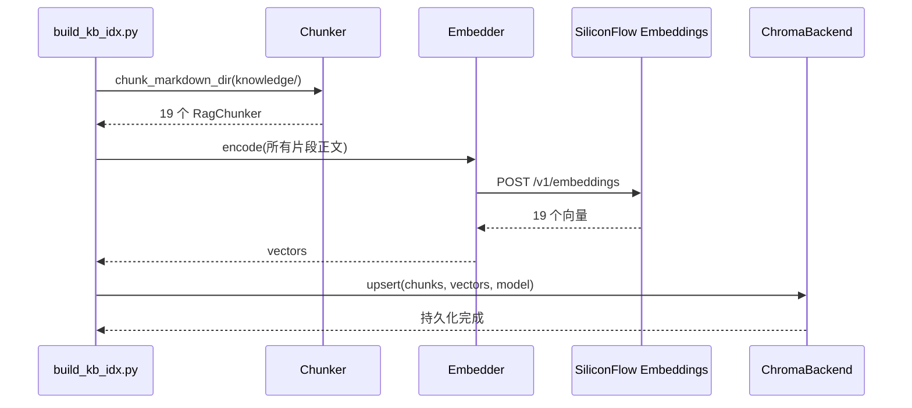
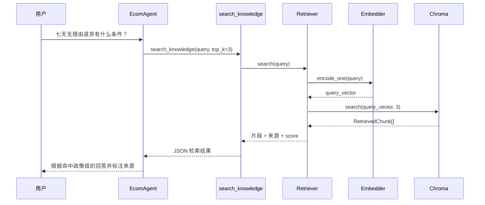
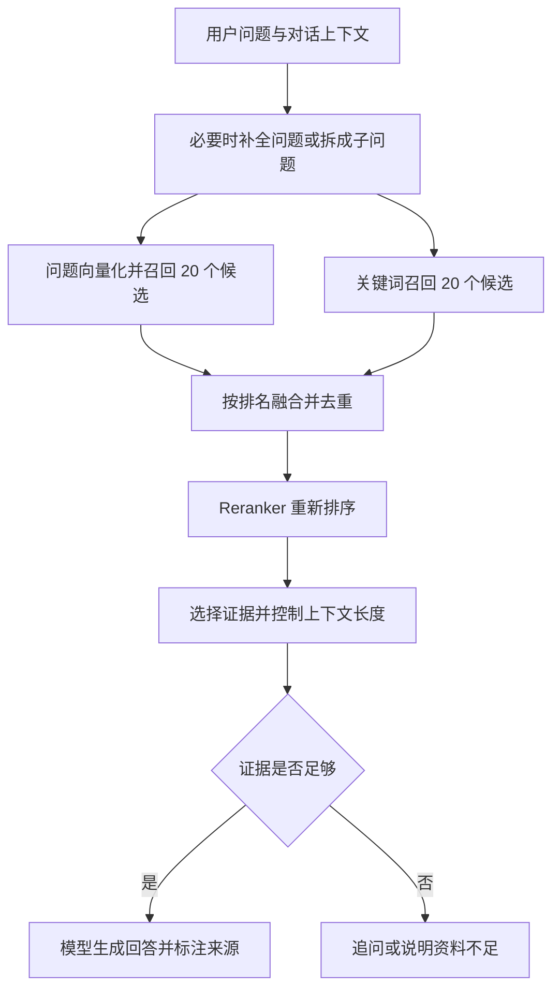

# 第5期：RAG 检索增强生成

本期为电商客服增加政策知识库。用户询问“七天无理由怎么算”“偏远地区包邮吗”“钻石会员有什么权益”时，Agent 不再只依赖模型训练时学到的知识，而是先从项目自己的 Markdown 文档中检索相关内容，再依据命中的原文回答。

本章会解释：

- RAG 解决什么问题，以及它为什么需要 Chunk、Embedding、Retriever 和 Backend。
- 本项目如何建立索引、查询索引，并将检索能力注册成 Agent 工具。
- 如何用硅基流动的 Embedding 服务跑通建库、直接检索和完整 Agent 演示。
- 基础流程是否标准，以及生产环境如何做增量更新、混合检索、版本发布和评测（见第 12 节）。

## 1. RAG 是什么

RAG 是 Retrieval-Augmented Generation，即“检索增强生成”。它将回答过程拆成两步：

1. **Retrieval（检索）**：从外部知识库找出与用户问题最相关的内容。
2. **Generation（生成）**：把检索结果交给大模型，让模型基于这些内容组织回答。

RAG 不会重新训练大模型，也不是把全部文档一次性塞进 Prompt。它只在回答当前问题时，取出少量相关片段作为上下文。

例如用户询问：

> 七天无理由退货有什么条件？

系统先检索出《退换货政策》中的“七天无理由退货”章节，再让客服模型根据该章节回答。这样做有三个直接好处：

- 业务知识可以通过修改 Markdown 更新，不必重新训练模型。
- 每次只传入少量相关片段，减少上下文长度和模型费用。
- 回答能够标注文档来源，降低模型编造政策的概率。

RAG 也不能自动保证答案正确。检索不到、切片不合理、Embedding 模型不合适，都会影响最终回答，因此需要分别验证“检索结果”和“模型回答”。

## 2. 四个核心组件

本项目中的四个核心组件如下：

| 组件 | 职责 | 输入 | 输出 | 使用阶段 |
| --- | --- | --- | --- | --- |
| Chunker | 将长文档切成可检索的小片段 | Markdown 文档 | `RagChunker[]` | 建库 |
| Embedder | 将文本转换为语义向量 | 文本或文本列表 | `list[float]` | 建库、查询 |
| Backend | 保存片段和向量，并执行相似度搜索 | 片段、向量或查询向量 | Top-K 命中片段 | 建库、查询 |
| Retriever | 组织完整查询过程 | 用户问题 | `RetrievedChunk[]` | 查询 |

它们的关系可以概括为：

```text
建库：文档 ──> Chunker ──> 文本片段 ──> Embedder ──> 向量 ──> Backend

查询：问题 ──> Embedder ──> 查询向量 ──> Backend ──> 相关片段
                  ▲                         ▲
                  └──────── Retriever ──────┘
```

### 2.1 Chunker：把文档变成检索单元

实现文件：[chunker.py](../src/mini_ecom_agent/rag/chunker.py)。

项目扫描 `knowledge/*.md`，先按照 Markdown 二级标题 `##` 分节。章节超过 `MAX_CHUNK_CHARS = 1200` 字符时，再按段落进行拆分。

每个片段保存为：

```python
@dataclass
class RagChunker:
    chunk_id: str
    doc: str
    section: str
    text: str
```

字段含义：

- `chunk_id`：片段唯一 ID，例如 `退换货政策#01-00`。
- `doc`：来源文档名，例如 `退换货政策`。
- `section`：来源章节，例如 `一、七天无理由退货`。
- `text`：实际用于向量化和交给模型的正文。

当前类名 `RagChunker` 实际表示“一条切片数据”。从命名上看，改为 `RagChunk` 会更准确；真正执行切分的是 `chunk_markdown_dir()` 等函数。

### 2.2 Embedder：把文本映射到语义空间

实现文件：[embedder.py](../src/mini_ecom_agent/rag/embedder.py)。

Embedding 模型将文本转换成固定长度的浮点数数组：

```text
“七天无理由退货”
        ↓
[0.012, -0.083, 0.117, ...]
```

语义接近的文本，其向量方向通常也更接近。因此，即使用户的说法和文档用词不完全相同，也可以通过向量相似度找到相关内容。

本项目的 `Embedder` 有两个主要入口：

```python
embedder.encode([chunk.text for chunk in chunks])  # 建库：批量编码
embedder.encode_one(query)                         # 查询：编码一个问题
```

它通过 OpenAI Python SDK 调用 OpenAI 兼容的 `/embeddings` 接口。聊天模型和 Embedding 模型是两套独立配置：

```text
LLM_*        -> 生成工具调用和最终客服回答
EMBEDDING_*  -> 文档及问题的向量化
```

DeepSeek 的聊天 API 不能直接替代 Embedding API。本项目使用硅基流动时，推荐 `BAAI/bge-m3`。

### 2.3 Backend：保存和检索向量

抽象接口：[base.py](../src/mini_ecom_agent/rag/backends/base.py)。

`VectorBackend` 规定所有向量后端必须提供：

```python
upsert(chunks, vectors, embedding_model)
search(query_vector, top_k)
size()
load()
expected_embedding_model()
```

当前可用实现是 [chroma_backend.py](../src/mini_ecom_agent/rag/backends/chroma_backend.py)。它负责：

- 将向量、片段原文及文档元数据写入 Chroma。
- 将索引持久化到 `sessions/chroma/`。
- 使用 cosine 距离查找最接近的向量。
- 将 Chroma 的距离转换为 `score = 1 - distance`，分数越大表示越相关。
- 在集合元数据中记录建库时使用的 Embedding 模型。

写入的数据关系如下：

```text
chunk_id  ─┐
doc       ─┤
section   ─┼──> Chroma collection: ecom-kb
text      ─┤
embedding ─┘
```

`upsert()` 当前采用全量重建策略：先删除同名 collection，再写入全部片段。修改知识文档或更换 Embedding 模型后，重新运行建库脚本即可。

配置中仍保留了 `numpy` 选项，但对应 Backend 尚未实现，因此本期演示统一使用 `chroma`。

### 2.4 Retriever：组织一次查询

实现文件：[retriever.py](../src/mini_ecom_agent/rag/retriever.py)。

Retriever 是 Embedder 与 Backend 之间的协调者，本身不切文档，也不保存向量：

```python
def search(self, query: str, top_k: int = 3):
    if not self._loaded:
        self.load()
    query_vector = self._embedder.encode_one(query)
    return self._backend.search(query_vector, top_k=top_k)
```

`load()` 还会比较：

```text
索引记录的 Embedding 模型 == 当前查询使用的 Embedding 模型
```

如果建库使用 `BAAI/bge-m3`，查询却改成另一个模型，两边的向量维度或语义空间可能不同，无法正确比较。本项目会直接要求重建索引。

## 3. 两条执行链路

RAG 包含“离线建库”和“在线检索”两条不同链路。

这里“离线”表示不在用户问答请求中执行，并不表示不联网；本项目建库仍会调用远程 Embedding API。建库任务与客服服务可以分别运行，客服重启无需重复向量化全部资料。

### 3.1 离线建库

入口：[build_kb_idx.py](../src/mini_ecom_agent/scripts/build_kb_idx.py)。



本项目当前的知识来源包括：

```text
knowledge/
├── 会员权益.md
├── 常见问题FAQ.md
├── 退换货政策.md
└── 配送说明.md
```

当前切分结果为 19 个片段。

### 3.2 在线检索和回答

入口：[knowledge.py](../src/mini_ecom_agent/tools/knowledge.py) 中的 `search_knowledge()`。



`knowledge.py` 使用模块级 `_retriever` 缓存 Retriever。第一次查询时创建 Embedder、Backend 并加载索引；后续查询复用同一个对象，避免每次重新加载 Chroma。

## 4. RAG 如何接入 Agent

RAG 在本项目中表现为一个普通 Function Calling 工具，而不是直接写死在 Agent 主循环中。

### 4.1 注册工具

[registry.py](../src/mini_ecom_agent/tools/registry.py) 注册执行函数：

```python
_TOOL_MAP = {
    # ...
    "search_knowledge": search_knowledge,
}
```

同时向模型描述参数：

```json
{
  "name": "search_knowledge",
  "parameters": {
    "type": "object",
    "properties": {
      "query": {"type": "string"},
      "top_k": {"type": "integer", "default": 3}
    },
    "required": ["query"]
  }
}
```

### 4.2 提示模型何时检索

[customer_service.py](../src/mini_ecom_agent/prompts/customer_service.py) 要求模型在遇到政策、规则、流程、时效、会员权益和 FAQ 问题时先调用 `search_knowledge`，再根据检索结果回答并标注来源。

### 4.3 ReAct 循环执行工具

[chat.py](../src/mini_ecom_agent/agents/chat.py) 的 `_react_loop()`：

1. 把工具定义交给模型。
2. 模型生成 `search_knowledge` 工具调用及参数。
3. `ToolManager` 根据工具来源，通过本地函数或 MCP 调用 `search_knowledge()`。
4. 将结果以 `role="tool"` 放回消息历史。
5. 模型读取命中片段并生成最终回答。

截至 2026-10-21，[MCP Server](../mcp_server/server.py) 已注册 `search_knowledge`。MCP 启用并成功发现该工具时，`ToolManager` 通过 MCP 调用，由服务端执行检索；MCP 关闭或初始化失败而降级时，使用本地注册表。两条路径最终都调用相同的业务函数，访问远程 Embedding API 和本地 Chroma。第 8 节明确关闭 MCP，因此该演示仍显示 `local`。

## 5. 配置环境

先安装项目依赖：

```powershell
uv sync
```

在项目根目录 `.env` 中配置聊天服务和 Embedding 服务。以“DeepSeek 负责聊天、硅基流动负责 Embedding”为例：

```dotenv
# 聊天模型：用于选择工具和生成客服回答
LLM_API_KEY=你的聊天模型密钥
LLM_BASE_URL=https://api.deepseek.com
LLM_MODEL_NAME=deepseek-flash

# Embedding 模型：用于文档和查询向量化
EMBEDDING_API_KEY=你的硅基流动密钥
EMBEDDING_BASE_URL=https://api.siliconflow.cn/v1
EMBEDDING_MODEL=BAAI/bge-m3

# RAG 存储
RAG_BACKEND=chroma
KB_DIR=knowledge
CHROMA_PERSISTENCE_DIR=sessions/chroma
CHROMA_COLLECTION=ecom-kb
```

硅基流动当前 Embeddings 接口文档：<https://api-docs.siliconflow.cn/docs/api/embeddings-post>。

不要将 API Key 写入代码或提交到 Git。本项目 `.gitignore` 已忽略 `.env` 和 `sessions/`。

## 6. 演示一：建立知识库索引

在项目根目录执行：

```powershell
uv run python src/mini_ecom_agent/scripts/build_kb_idx.py --backend chroma
```

预期过程：

```text
[1/3] 扫描并切分 markdown 文档...
   - 会员权益: 5 chunk
   - 常见问题FAQ: 4 chunk
   - 退换货政策: 4 chunk
   - 配送说明: 6 chunk
   合计 19 个 chunk

[2/3] 调用 BAAI/bge-m3 批量向量化...
   完成，向量维度 = ...

[3/3] 写入 chroma 索引...
   已写入 19 条向量

索引构建完成。
```

完成后，索引位于：

```text
sessions/chroma/
```

以下情况需要重新构建：

- 修改、增加或删除 `knowledge/*.md`。
- 修改切片策略。
- 更换 `EMBEDDING_MODEL`。
- 删除了 `sessions/chroma/`。

## 7. 演示二：绕过大模型，直接验证检索

先单独测试 Retriever，可以把“检索问题”和“模型回答问题”分开排查。

在 PowerShell 中执行：

```powershell
@'
import json
import sys

from mini_ecom_agent.tools.knowledge import search_knowledge

sys.stdout.reconfigure(encoding="utf-8")

# 使用 Unicode 转义可避免部分 Windows 终端在管道中损坏中文。
query = "\u4e03\u5929\u65e0\u7406\u7531\u9000\u8d27\u6709\u4ec0\u4e48\u6761\u4ef6\uff1f"
result = search_knowledge(query, top_k=3)
print(json.dumps(result, ensure_ascii=False, indent=2))
'@ | uv run python -
```

2026-10-20 使用硅基流动 `BAAI/bge-m3` 和当前知识库的实际验证结果：

```json
{
  "success": true,
  "backend": "chroma",
  "query": "七天无理由退货有什么条件？",
  "results": [
    {
      "doc": "退换货政策",
      "section": "一、七天无理由退货",
      "score": 0.8137,
      "text": "【退换货政策 · 一、七天无理由退货】..."
    },
    {
      "doc": "退换货政策",
      "section": "四、特殊场景",
      "score": 0.7068,
      "text": "【退换货政策 · 四、特殊场景】..."
    },
    {
      "doc": "退换货政策",
      "section": "三、退款流程",
      "score": 0.6723,
      "text": "【退换货政策 · 三、退款流程】..."
    }
  ]
}
```

实际 `text` 会包含完整片段，这里为控制篇幅进行了省略。Score 会受到模型、索引内容和切片策略影响，不应把上述数值写成业务阈值。

第一条命中了正确文档和章节，说明以下环节已共同工作：

```text
Embedding API -> 查询向量 -> Chroma 相似度检索 -> 原文与元数据恢复
```

## 8. 演示三：通过 Agent 完成检索增强回答

为了单独观察 RAG，可暂时关闭 MCP，让所有工具走本地注册表：

```powershell
$env:MCP_ENABLED = "false"
uv run python src/mini_ecom_agent/main.py
```

输入：

```text
七天无理由退货有什么条件？运费谁承担？
```

正常情况下，终端会出现类似日志：

```text
[调用工具] search_knowledge(query='七天无理由退货有什么条件？运费谁承担？', top_k=3)
工具来源：local
[工具结果] {"success": true, "backend": "chroma", ...}
```

模型随后应依据《退换货政策》说明：签收后 7 天内、商品不影响二次销售、部分商品除外，以及无理由退货的运费规则。最终措辞由模型决定，关键判断标准是：

- 终端确实出现了 `search_knowledge` 调用。
- 工具返回 `success: true`。
- 命中来源包含《退换货政策》相关章节。
- 最终回答与命中原文一致，并标注来源。

如果终端只出现自然语言回答，没有工具调用日志，不能据此认定本次使用了 RAG。

## 9. 如何判断问题出在哪一层

| 现象 | 可能原因 | 检查方式 |
| --- | --- | --- |
| 构建时提示知识库不存在 | `KB_DIR` 配置错误或目录缺失 | 检查 `knowledge/` 和 `.env` |
| Embedding 返回 404 | 地址不支持 `/embeddings`，或模型 ID 不存在 | 检查 `EMBEDDING_BASE_URL` 和 `EMBEDDING_MODEL` |
| 提示 collection 不存在 | 尚未建立索引，或持久化路径不一致 | 重新运行建库脚本 |
| 提示 Embedding 模型不一致 | 建库和查询使用了不同模型 | 使用当前模型重新建库 |
| 检索成功但命中文档不相关 | 查询表达、切片或模型效果不理想 | 先直接运行第 7 节，观察 Top-K |
| 直接检索正确，Agent 回答错误 | 模型没有正确使用工具结果 | 检查工具消息和系统提示词 |
| Agent 没调用 `search_knowledge` | 模型未选择工具或工具未注册 | 检查注册表、Prompt 和调用日志 |
| 开启 MCP 后 RAG 仍显示 `local` | 客户端已降级，或正在运行的旧服务未提供该工具 | 检查连接日志和工具列表；当前源码已注册它，更新服务后重启客户端 |

推荐的排查顺序是：

```text
知识文件 -> Chunk -> 建库向量 -> 直接检索 -> 工具返回 -> Agent 最终回答
```

不要一开始就只看最终回答，否则无法判断问题来自检索还是生成。

## 10. 当前实现的边界

这个实现适合教学和小型知识库，仍有以下边界：

- Chunker 按字符和 Markdown 标题切分，没有按模型 token 精确计算长度。
- 查询只做向量召回，没有关键词检索、混合检索或 Reranker 精排。
- Backend 每次建库采用全量覆盖，没有增量更新和文档版本管理。
- 查询固定返回 Top-K，没有最低相关度阈值；低相关结果仍可能返回。
- Embedding 请求是同步调用，查询时会等待远程服务响应。
- `numpy` Backend 尚未实现，当前应使用 Chroma。

后续可以按以下顺序增强：

1. 为 Chunk 增加 token 级长度控制和重叠窗口。
2. 增加最低分数过滤，避免把明显不相关的片段交给模型。
3. 增加 BM25 + 向量的混合召回。
4. 使用 `BAAI/bge-reranker-v2-m3` 或 Qwen Reranker 对候选片段精排。
5. 增加检索评测集，记录 Recall@K、MRR 等指标。

## 11. 一句话理解本项目的 RAG

```text
Chunker 把政策文档切成片段，Embedder 把片段和问题变成向量，
Backend 保存并比较向量，Retriever 组织查询，search_knowledge 将结果交给 Agent，
最后由聊天模型根据命中的政策原文生成回答。
```

## 12. 这是标准流程吗？生产环境如何工程化

### 12.1 你的理解对应基础向量 RAG 流程

“读取资料 → 分块 → 向量化 → 存入向量库；用户提问 → 问题向量化 → 从库中召回”是常见的基础向量 RAG 流程。完整问答还要接上“整理召回片段 → 交给聊天模型 → 生成带来源的回答”。如果只返回命中片段，完成的是检索部分。

RAG 是一种架构模式，没有要求所有项目执行完全相同的步骤；检索也可以使用关键词索引、数据库或其他信息源，不一定只靠向量库。微软的架构指南同样将数据入库与应用问答分开描述，并区分固定流程和 Agent 按需检索。[参考：RAG 设计与评估指南](https://learn.microsoft.com/en-us/azure/architecture/ai-ml/guide/rag/rag-solution-design-and-evaluation-guide)

“启动 RAG”可以进一步拆成三件事：

| 动作 | 执行时机 | 是否处理全部资料 |
| --- | --- | --- |
| 初始化存储 | 首次部署，准备 collection、向量维度、距离度量等 | 不一定；创建空容器不等于完成建库 |
| 导入或更新索引 | 首次导入、资料变更、切片或向量模型变更 | 首次通常全量；后续可增量 |
| 启动问答服务 | 程序启动或重启 | 通常连接并使用现有索引 |

创建 collection 的具体时机由实现决定。例如本项目先得到向量，再在 `ChromaBackend.upsert()` 中删除并创建集合、写入数据。不存在“必须先创建空向量库，才能读取文件”的固定顺序。

项目的日常操作应当是：

```text
首次使用：建库脚本 → 生成持久化索引 → 启动客服 → 查询
次日重启：启动客服 → 首次检索时加载已有索引 → 查询
修改资料：重新运行建库脚本 → 重启持有旧集合的客服/MCP 服务 → 查询
```

当前代码没有自动监控 Markdown 的变化，也没有索引版本热切换。只修改文件并不会立即改变召回结果；更新后重启相关进程，是为了重新建立对当前集合的引用。

### 12.2 工程化主要增强哪些环节

你说的“工厂化”可以理解为：把手工执行的脚本，变成可重复运行、可恢复、可观测的数据处理与检索服务。以下是结合本项目的演进建议，不表示这些功能已经实现。

| 环节 | 当前项目 | 面向生产的增强方向 | 解决的问题 |
| --- | --- | --- | --- |
| 资料接入 | 根目录下的 Markdown 文件 | 数据连接器、解析 PDF/网页/表格、必要时 OCR | 支持多种来源，保留文档结构 |
| 内容处理 | 标题分节、按段落拆分 | 去重、清理页眉页脚，保存表格语义和来源定位 | 减少重复或无意义片段 |
| 切片 | 约 1200 字符的拆分目标 | 按 token 限长、保留标题层级，按评测决定是否重叠 | 避免超长输入和语义断裂 |
| 元数据 | 文档名、章节、片段 ID | 文档版本、生效时间、来源 URL、访问范围 | 精确引用、过滤过期内容和限定查询范围 |
| 向量化 | 同步分批调用 API | 批处理、限流、超时、退避重试、结果缓存 | 控制成本，并从失败位置继续 |
| 更新 | 删除同名集合后全量重建 | 识别新增/修改/删除，增量更新；大变更构建新版本 | 降低重复计算，避免查询空窗 |
| 检索 | 单路向量 Top-K | 元数据过滤、关键词与向量混合召回、可选重排序 | 兼顾准确术语与语义表达 |
| 回答 | 工具结果送回聊天模型 | 去重、上下文长度控制、引用核验、证据不足时追问 | 避免无依据回答与上下文噪声 |
| 运维 | 控制台日志 | 分阶段耗时、失败率、费用、检索效果与版本回归 | 找到瓶颈并验证改动是否有效 |

增量索引、多来源接入以及按访问范围检索，是实际 RAG 服务常见的工程能力。[参考：RAG 与搜索服务](https://learn.microsoft.com/en-us/azure/search/retrieval-augmented-generation-overview)

### 12.3 例子：只修改退货政策，为什么不用重算全部知识

假设有 10,000 份文档，今天只修改《退换货政策》。可以维护一份文档清单，记录 `document_id`、内容哈希、文档版本和处理状态：

1. 比较本次源文件与已入库版本，找出新增、修改和删除的文档。
2. 只解析、切分新增或修改的文档；未变更的文档跳过。
3. 对新片段生成向量。缓存键至少包含“实际送入模型的文本、模型版本、向量维度及相关编码参数”，避免错误复用。
4. 新版本准备完成后，发布对应片段，并停用或删除旧版本片段。
5. 源文档被删除时，同步处理其所有旧片段，避免继续回答已撤销政策。
6. 保存任务进度。重试同一任务时，用确定的 ID 和版本避免重复插入。

不能只添加新片段：旧条款如果还留在索引中，可能与新政策同时被召回。文档顺序变化也可能导致基于位置的片段 ID 改变，因此需要文档与片段的关联记录，不能只依靠哈希去重。

本项目的 `upsert()` 名称容易引起误解：它当前执行的是“删除 collection 后全量写入”，还不是生产意义上的逐条增量 upsert。

更换 Embedding 模型时，通常需要重新生成全部相关文档的向量。更稳妥的发布方式是：

```text
旧索引 v1 继续服务
        ↓
在新 collection 构建 v2，绑定对应 Embedding 模型与参数
        ↓
检查条数、模型配置，并运行检索评测
        ↓
切换应用的索引版本和查询 Embedder
        ↓
观察效果；保留 v1 以便回退
```

这里的版本切换是建议方案，需要在应用中实现路由或配置切换；当前代码没有自动完成这些步骤。只切换 collection 而继续使用旧查询模型，同样会产生不兼容问题。

### 12.4 查询为什么会增加混合召回和 Reranker

单路向量检索适合语义相近的表达，但精确型号、编号、专有词可能需要关键词检索辅助。混合检索将两类候选合并，Reranker 再对“问题 + 候选原文”重新打分；它们是不同阶段。[参考：检索方式与重排序](https://learn.microsoft.com/en-us/azure/architecture/ai-ml/guide/rag/rag-information-retrieval)

以下是可选的增强查询流程，数量只是教学示例：



应用有租户、用户权限或政策有效期时，应限定可检索的候选范围，并确保进入重排序和生成阶段的原文已经通过访问检查。不能依赖最终 Prompt 决定是否泄露已经检索到的内容。

这里有两个不同的数量：召回阶段可以保留较多候选，最终只选少量片段交给模型。候选多并不意味着全部塞进 Prompt。关键词分数与向量分数也不宜直接相加，可以使用按排名融合的方式，例如 RRF。

余弦相似度不是“答案正确的概率”，`0.8137` 不表示 81.37% 的正确率；不同模型、语料和重排序器的分数也不能共用一个固定阈值。是否启用重排序、召回多少条、何时判定证据不足，都应通过本项目的问题集来调节。

### 12.5 固定检索流程与 Agent 按需检索

常见固定流程是“收到知识问答 → 检索 → 生成”。本项目则由模型通过 Function Calling 选择 `search_knowledge`，也可以选择订单、商品或物流工具；如果结果不足，模型还有机会换个问题继续检索。

因此，本项目可以看作“Agent 按需调用基础向量检索”的组合：外层有工具选择能力，内层 Retriever 仍然是“问题向量化 → Chroma Top-K”。使用 Agent 并不会自动获得混合检索、精排或增量建库能力。

以电商客服为例，政策说明适合文档检索；“我的订单现在发货了吗”应由实时订单工具查询。每天把所有实时订单转成文档并重新向量化，既不利于时效，也不能替代精确订单查询。

### 12.6 这个项目适合如何逐步增强

当前只有 4 份文档、19 个片段，可以继续使用全量建库，不必为了工程化立即引入任务队列或多种数据库。建议根据问题逐步增加能力：

1. **先建立评测基线**：准备一组真实问题，标记应命中的章节和应回答的要点，也包含知识库没有答案的问题。每次改切片、模型或 Prompt 后重复评测。
2. **再完善错误处理和证据判断**：检查 Embedding 失败、空索引、低相关结果时的表现；答案应能引用来源，证据不足时应追问或说明限制。
3. **发现召回不足后，再尝试混合检索和精排**：对同一批问题比较 Recall@K、首个相关结果的排名、答案是否忠于原文，以及耗时与费用。
4. **资料量或更新频率增加后，再做增量处理和版本发布**：记录哈希、变更清单与任务状态，避免每次更新都删除正在服务的集合。

评测时分别观察“正确章节有没有被检索到”和“模型有没有按证据回答”。对于复杂问题，还要检查答案需要的多个证据是否齐全；单条检索成功不足以证明整个问答系统可靠。
