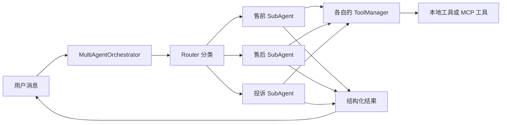

# 第6期：Multi-Agent 协作

本期将一个客服 Agent 拆为“路由器 + 售前、售后、投诉三个专家”。用户仍面对同一个“小夕”，程序每轮先判断问题类型，再让对应专家使用自己的提示词和工具回答。三个专家共用同一个模型客户端；这里的“多 Agent”是**角色、职责与工具权限的划分**，当前代码按顺序执行，并没有并行运行三个模型，也没有专家之间的自动转交。

## 1. 为什么拆分

单 Agent 需要同时遵守商品推荐、订单处理、投诉安抚等规则，提示词和工具列表会越来越大。拆分后，售前只看到商品及政策相关工具，投诉专家只看到订单查询与政策检索，减少无关工具进入模型上下文。代价是每轮增加一次路由模型调用；路由错误时，后续专家也可能选错。

本项目的调用链：



代码入口是 [main.py](../src/mini_ecom_agent/main.py)。`MULTI_AGENT_ENABLED=true` 时创建 [MultiAgentOrchestrator](../src/mini_ecom_agent/multi_agent/orchestrator.py)；设为 `false` 时使用原来的单 Agent [EcomAgent](../src/mini_ecom_agent/agents/chat.py)。

## 2. 三种角色如何分工

[sub_agent.py](../src/mini_ecom_agent/multi_agent/sub_agent.py) 中的 `AGENT_CONFIG` 定义了角色、系统提示词和允许使用的工具。提示词正文在 [prompts/agents.py](../src/mini_ecom_agent/prompts/agents.py)。

| 路由结果 | 典型问题 | 当前真正可用的工具 |
| --- | --- | --- |
| `presale` | 商品、价格、库存、购买建议 | `query_product`、`search_knowledge`、`list_user_orders` |
| `postsale` | 订单、物流、退货、退款；普通问候默认走这里 | `query_order`、`query_logistics`、`apply_refund`、`search_knowledge`、`list_user_orders` |
| `complaint` | 明确投诉、强烈不满 | `query_order`、`search_knowledge` |

`list_user_orders(user_name)` 根据模拟订单的 `user` 字段筛选，只返回订单号、状态、商品名、金额和下单时间等摘要。它已接入 [工具注册表](../src/mini_ecom_agent/tools/registry.py) 和 [MCP Server](../mcp_server/server.py)。用户名是必填参数；用户没提供订单号、也没说明姓名时，应先询问姓名，再列出匹配订单，请用户确认具体是哪一单。当前模拟项目没有登录身份校验，不能把输入的姓名当作真实身份认证。

工具权限由 [ToolManager](../src/mini_ecom_agent/tools/manager.py) 的 `allowed_tools` 过滤实现。即使工具写在提示词里，只要不在实际工具定义中，模型就无法发起对应的 Function Calling。退款操作仍需在业务层确认，本项目目前主要靠提示词要求模型先确认。

## 3. 一轮对话的执行顺序

以“查询 ORD-20240115-001 的发货状态”为例：

1. `Orchestrator.chat()` 把用户消息放入共享历史。
2. [Router](../src/mini_ecom_agent/multi_agent/router.py) 读取最近几条对话并调用模型，要求只返回 `presale`、`postsale` 或 `complaint`；未匹配时默认 `postsale`。
3. 编排器选出对应 `SubAgent`，拼入该专家的 system prompt、记忆、旧对话摘要和当前历史。
4. `SubAgent.handle()` 执行 ReAct 循环。模型可调用工具；工具结果作为 `role="tool"` 消息放回模型上下文，再由模型组织答复。
5. 编排器将最终答复转换为 `CustomerServiceResponse`，更新短期记忆，保存会话。如果历史超过 `history_threshold`，还会生成摘要。

这里的“路由”每轮都会重新执行。当前没有一个长期占用会话的专家，也没有专家之间的消息队列。`SubAgent` 返回工具调用过程和最终文本；编排器负责保存历史与返回统一的客服结果。

结构化结果包括 `intent`、`confidence`、`reply`、`requires_human` 和 `follow_requestions`。编排器优先尝试 SDK 的 `beta.chat.completions.parse`；接口不支持时，再用普通聊天请求让模型输出 JSON 并由 Pydantic 校验。因此如果服务不支持结构化输出，仍可能多一次模型调用。

## 4. 工具与 MCP 的关系

每个子 Agent 各创建一个 `ToolManager`。`MCP_ENABLED=true` 时，三个管理器分别尝试连接同一个 MCP 地址，所以启动时可能出现三条连接日志。当前 [MCP Server](../mcp_server/server.py) 发布 `query_order`、`list_user_orders`、`query_product`、`query_logistics`、`apply_refund`、`search_knowledge`；连接成功后，`ToolManager` 还会补充服务端没有的本地工具。连接失败则每个管理器分别降级到本地工具。

`MCP_ENABLED=true` **不会启动服务端**。需要 MCP 时，先在单独终端运行：

```powershell
uv run python mcp_server/server.py
```

再启动客服。只想理解多 Agent 路由时，可暂时设 `MCP_ENABLED=false`，排除服务端状态的影响。政策类问题需要第 5 期构建好的 RAG 索引；订单示例使用内置模拟数据，不依赖知识库索引。

## 5. 运行演示

在项目根目录的 PowerShell 中设置本次演示用的配置：

```powershell
$env:MULTI_AGENT_ENABLED = "true"
$env:MCP_ENABLED = "false"
$env:MEMORY_ENABLED = "false"
$env:SESSION_PATH = "sessions/demo-multi-agent.json"
$env:PYTHONIOENCODING = "utf-8"
uv run python src/mini_ecom_agent/main.py
```

`.env` 还需要有效的 `LLM_API_KEY`、`LLM_BASE_URL` 和 `LLM_MODEL_NAME`。其中 `LLM_BASE_URL` 是 API 地址，`LLM_MODEL_NAME` 必须是该服务实际支持的模型名，不能把 URL 传到 `model` 参数。

先输入：

```text
请查询订单 ORD-20240115-001 的状态，并告诉我是否已经发货。
```

路由成功时会看到类似：

```text
🔀 [路由] → 小夕-售后
  🔧 [小夕-售后·调用工具] query_order(order_id='ORD-20240115-001')
工具来源：local
  📋 [小夕-售后·工具结果] {"success": true, "order": ...}
🤖 小夕: ...
```

其中 `工具来源：local` 是因为演示关闭了 MCP。模型是否调用工具由模型决定；判断是否真的查询订单，应看调用日志和工具返回，而不是只看最终回答。

若不知道订单号，可输入“我叫小明，忘了订单号，帮我看看我的订单”。售后专家应调用 `list_user_orders(user_name='小明')`；返回 `count=1` 和 `ORD-20240115-001`。这里的用户名只是模拟数据筛选条件。正式业务必须从已认证会话取得用户身份，不能只凭顾客口述姓名查询订单。

接着可以分别尝试：

| 输入 | 预期路由 |
| --- | --- |
| `有适合跑步的运动鞋吗？` | 售前 |
| `订单 ORD-20240115-001 的物流到哪了？` | 售后 |
| `这件商品有质量问题，我要投诉！` | 投诉 |

这些是路由意图示例，模型输出仍可能受上下文影响。输入 `reset` 可清空当前会话历史；输入 `quit` 会保存会话并关闭工具连接。第 7 期说明记忆如何参与这一流程。

## 6. 当前边界

- 三个子 Agent 共用模型、共享对话历史；这是顺序路由，不是并行协作，也没有真正的专家转交机制。
- 路由只依据模型给出的标签，没有置信度阈值或规则兜底；未识别标签时默认售后。
- `list_user_orders` 目前只在内存中的模拟订单上按用户名精确匹配；没有真实账户鉴权、分页或数据库查询。
- 投诉升级、退款确认目前主要由提示词约束，没有独立的审批流程。
- 三个独立 `ToolManager` 会重复建立 MCP 连接。需要减少连接数时，可以再设计共享 MCP 客户端。

调试时依次查看“路由日志 → 当前专家可用工具 → 工具来源与返回 → 最终结构化结果”，就能判断问题落在哪一层。
