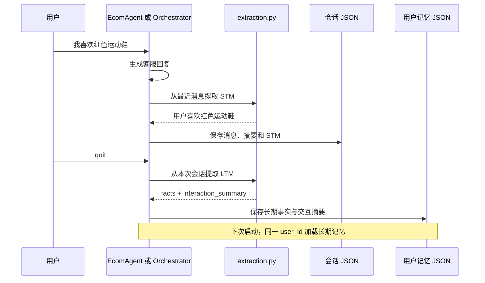

# 第7期：Memory 记忆

本期让客服从对话中提取用户事实，并在后续回答时使用。项目分为短期记忆（本次会话关注的信息）和长期记忆（跨会话保留的用户信息）。两者都由聊天模型从对话中提取，保存位置、更新时机和作用范围不同。

## 1. 记忆与对话历史有什么区别

对话历史保存用户和客服说过的消息；记忆保存从消息中抽出的少量关键事实。例如：

```text
用户原话：我喜欢红色运动鞋，预算大概 300 元。
短期事实：用户喜欢红色运动鞋；预算约 300 元。
长期事实：用户偏好红色系运动鞋（preference）。
```

这只是示意，事实的具体措辞由模型生成。记忆不会替代原始会话记录：会话历史负责还原对话，记忆让后续轮次和新会话更容易看到用户偏好。当前实现是**文本事实 + JSON 文件**，没有向量化；第 5 期 RAG 的向量库用于检索政策文档，不用于保存用户记忆。

| 层 | 更新时机 | 存放位置 | 何时加载 |
| --- | --- | --- | --- |
| 短期记忆 STM | 每轮客服回复完成前，从最近消息提取 | 进程内 `ShortTermMemory.facts`；同时写入会话 JSON | 恢复同一个会话时从会话文件读取 |
| 长期记忆 LTM | 用户 `quit/exit` 或关闭程序时，从本次对话和摘要提取 | `sessions/memory/<user_id>.json` | 新建 Agent 时读取同一用户的文件 |

实现由 [MemoryManager](../src/mini_ecom_agent/agents/memory/manager.py) 协调；[ShortTermMemory](../src/mini_ecom_agent/agents/memory/short_term.py) 和 [LongTermMemory](../src/mini_ecom_agent/agents/memory/long_term.py) 分别保存两种状态。

## 2. 本项目的完整链路



启动时，[chat.py](../src/mini_ecom_agent/agents/chat.py) 或 [orchestrator.py](../src/mini_ecom_agent/multi_agent/orchestrator.py) 创建 `MemoryManager`。它先按 `MEMORY_USER_ID` 加载长期记忆；如果会话文件存在，再恢复短期记忆和消息历史。两种 Agent 模式共用这套记忆模块。

每轮组装模型请求时，`build_memory_prompt_sections()` 把已有的短期、长期记忆加入 system 消息。之后 Agent 才发送本轮用户消息、执行工具调用和生成回答。因此，本轮新提取的短期事实从**下一轮**起进入模型上下文；长期事实在下次启动时进入上下文。

## 3. 短期记忆怎样产生

[extraction.py](../src/mini_ecom_agent/agents/memory/extraction.py) 的 `extract_short_term_facts()` 将最近消息转成“用户/客服/工具”的文字记录，再用 [STM 提取提示词](../src/mini_ecom_agent/prompts/memory.py) 让模型每行输出一条事实。程序按文本去重，合并到 `stm.facts`；模型回复“无新信息”时保留原结果。

例如用户说“我喜欢红色运动鞋”，下一轮输入 `memory` 可能看到：

```text
--- 短期记忆（本次对话）---
  - 用户喜欢红色运动鞋
```

展示内容取决于模型提取结果，不是固定字符串。短期记忆的 `to_dict()/from_dict()` 与 [storage.py](../src/mini_ecom_agent/agents/storage.py) 配合，写入当前会话文件的 `short_term_memory` 字段。重启后若继续使用同一 `SESSION_PATH`，它会恢复；换一个会话文件则不会带入此前 STM。

## 4. 长期记忆怎样产生

用户退出时，`close()` 调用 `MemoryManager.consolidate_to_ltm()`。它把当前消息和已有摘要交给 `extract_long_term_facts()`，要求模型返回：

```json
{
  "facts": [
    {"content": "用户偏好红色系运动鞋", "category": "preference"}
  ],
  "interaction_summary": "用户咨询了运动鞋，预算约 300 元"
}
```

`MemoryFact` 保存 `content`、`category`、`created_at` 和 `source_session`。`LongTermMemory.add_facts()` 按事实文本忽略大小写去重，最多保留 `MAX_FACTS_LIMIT` 条；交互摘要另存，并在注入提示词时只取最近三条。文件写入使用临时文件和原子替换，编码为 UTF-8。

如果没有消息也没有摘要，`close()` 不做长期提取。长期提取需要一次额外的模型请求，退出速度与模型响应有关；若模型没有返回合法 JSON，目前会得到“提取失败”的摘要提示，而不是自动重试。

## 5. 如何查看与调用记忆

客服 CLI 的 `memory` 命令直接显示进程中的短期事实、长期事实和最近交互摘要；它本身不请求模型。`reset` 清空**当前会话消息和短期记忆**，并删除当前会话文件；长期记忆仍保留。

[memory_tool.py](../src/mini_ecom_agent/tools/memory_tool.py) 还提供 `recall_user_memory`，返回 `short_term_memory`、`long_term_memory` 与 `interaction_summaries`。它已在本地 [工具注册表](../src/mini_ecom_agent/tools/registry.py) 中注册，所以单 Agent 模式可通过 Function Calling 使用。参数 `query` 当前尚未做筛选，调用时返回的是当前用户全部已加载事实。

多 Agent 模式下，三个子 Agent 的 `allowed_tools` 都没有包含 `recall_user_memory`，因此模型不能主动调用它；但编排器仍会把记忆作为 system 消息注入对应专家。MCP Server 目前也未发布这个记忆工具。如果日志显示“工具来源：local”，说明调用的是本地注册表，而不是 MCP。

## 6. 配置与跨会话演示

在项目根目录准备 `.env` 中的 `LLM_API_KEY`、`LLM_BASE_URL` 和服务实际支持的 `LLM_MODEL_NAME`。下面用独立的演示用户和会话文件，避免混入已有的 `default` 用户记录。先在 PowerShell 运行：

```powershell
$env:MEMORY_ENABLED = "true"
$env:MULTI_AGENT_ENABLED = "true"
$env:MCP_ENABLED = "false"
$env:MEMORY_USER_ID = "demo-memory-7"
$env:MEMORY_DIR = "sessions/memory"
$env:SESSION_PATH = "sessions/demo-memory-first.json"
$env:PYTHONIOENCODING = "utf-8"
uv run python src/mini_ecom_agent/main.py
```

输入以下内容，再输入 `memory` 查看本次对话提取的短期事实，最后输入 `quit` 触发长期提取：

```text
我喜欢红色运动鞋，预算大概 300 元。以后推荐鞋子时请记住。
memory
quit
```

退出后可以查看 `sessions/memory/demo-memory-7.json`。其中 `facts` 与 `interaction_summaries` 是长期记忆；`sessions/demo-memory-first.json` 中的 `short_term_memory` 是第一次会话的短期记忆。若模型没有提取出对应事实，应先检查模型返回内容和提取提示词，不要只依据最终客服回复判断记忆已经写入。

接着在**同一个 PowerShell 窗口**换一个会话文件，保持 `MEMORY_USER_ID` 不变：

```powershell
$env:SESSION_PATH = "sessions/demo-memory-second.json"
uv run python src/mini_ecom_agent/main.py
```

进入后先输入 `memory`：新会话的短期记忆应为空，长期记忆应来自同一个用户文件。再问“你记得我喜欢什么颜色的鞋吗？”，就能检查长期记忆是否进入模型上下文。这里换了会话文件，避免模型仅凭旧对话历史回答，从而更清楚地验证跨会话记忆。

若要演示模型主动调用 `recall_user_memory`，把 `MULTI_AGENT_ENABLED` 改为 `false`，再运行单 Agent 模式。模型是否调用工具仍由它决定；需要检查终端调用日志，不能只看回答是否提到了偏好。

## 7. 当前实现的边界

- STM 和 LTM 都靠模型抽取。模型遗漏事实、返回错误格式或抽取不准，会直接影响记忆内容。
- `MEMORY_USER_ID` 是文件名级隔离，当前没有登录鉴权；生产系统需要把记忆绑定到真实用户身份，并规定保留、删除和访问权限。
- `MAX_FACTS_LIMIT` 只限制事实条数；交互摘要会持续累积到文件中，虽然提示词只注入最近三条。
- 长期事实的 `source_session` 字段当前没有填入实际会话 ID；`recall_user_memory(query=...)` 也还没有关键词过滤或语义检索。
- `reset` 只处理当前会话和 STM；如需同时清除 LTM，代码提供 `MemoryManager.reset_all()`，CLI 尚未暴露该命令。

记忆效果应分别验证“抽取结果 → 文件内容 → 新请求中的记忆注入 → 最终回答”，而不是仅根据一次回答判断整条链路已经生效。
