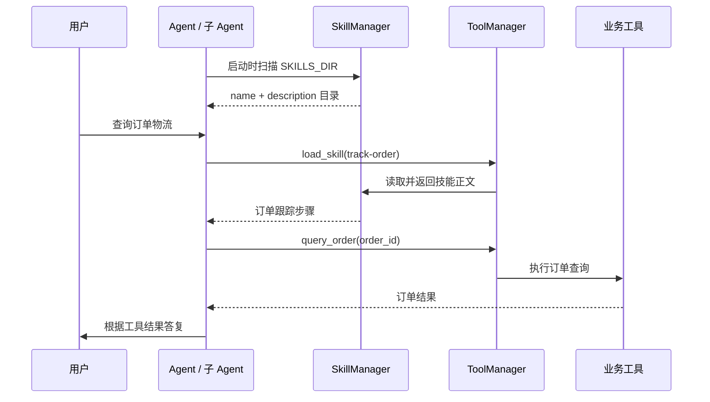

# 第8期：Skills 可复用技能

本期把常见客服处理流程写成独立的 `SKILL.md`。启动时，Agent 发现技能并把名称、用途放进系统提示；处理具体问题时，模型可调用 `load_skill` 取得完整步骤，再调用订单、商品、知识库等工具完成操作。**Skill 提供做事流程，工具负责执行动作**；加载技能本身不会查询订单或申请退款。

## 1. Skill 解决什么问题

工具定义回答“能做什么”，例如 `query_order(order_id)` 说明如何查订单；Skill 回答“遇到某类问题该按什么顺序做”，例如先确认订单、检查退货政策，再让用户确认退款意愿。把流程放到文件里，便于复用和修改，也避免每轮都把全部流程正文塞进 system prompt。

| 组成 | 本项目中的例子 | 作用 |
| --- | --- | --- |
| 工具 | `query_order`、`search_knowledge`、`apply_refund` | 提供可调用的操作及参数 |
| Skill | `process-return/SKILL.md` | 指导模型如何组合已有工具处理退货 |
| RAG 知识库 | 退换货政策文档 | 提供需检索核实的业务事实 |
| Memory | 用户偏好、历史事实 | 提供当前用户的上下文 |

Skill 不是新的 Python 函数，也不会自动增加工具权限。`SKILL.md` 中写了某个工具名，并不代表当前 Agent 一定能调用它。政策、时效等实际业务信息应以 `search_knowledge` 的检索结果和工具返回为准，不能只凭技能正文中的示例措辞答复。

## 2. 技能文件长什么样

技能位于 [skills 目录](../src/mini_ecom_agent/skills)。每个技能占一个子目录，目录下有 `SKILL.md`；文件开头是 `name` 和 `description`，正文是操作步骤。例如：

```markdown
---
name: track-order
description: 当用户想查订单状态、物流进度时使用。
---

## 订单跟踪流程

1. 确定订单号；没有订单号时先确认用户姓名，再列出订单。
2. 调用 query_order 查询订单。
3. 已发货时调用 query_logistics 查询物流。
4. 根据工具结果答复用户。
```

上面是结构示意，项目实际内容见 [track-order/SKILL.md](../src/mini_ecom_agent/skills/track-order/SKILL.md)。当前已有三个技能：

| 技能 | 适用场景 | 典型工具 |
| --- | --- | --- |
| [`process-return`](../src/mini_ecom_agent/skills/process-return/SKILL.md) | 退货、退款、换货 | `query_order`、`search_knowledge`、`apply_refund` |
| [`track-order`](../src/mini_ecom_agent/skills/track-order/SKILL.md) | 查订单、查物流 | `list_user_orders`、`query_order`、`query_logistics` |
| [`product-recommend`](../src/mini_ecom_agent/skills/product-recommend/SKILL.md) | 商品推荐 | `recall_user_memory`、`query_product` |

`list_user_orders` 的 `user_name` 参数必填。用户既没给订单号，也没提供姓名时，要先询问姓名，不能直接调用空参数。在当前模拟项目中，姓名只是订单筛选条件，不是身份认证。

## 3. 从发现到使用的调用链

`SkillManager` 在初始化时扫描 `SKILLS_DIR` 的直接子目录，读取各 `SKILL.md` 的 frontmatter；缺少名称或描述的文件会被跳过。`get_catalog()` 返回名称和描述，`build_catalog_prompt()` 将这份目录加入 Agent 的 system prompt。模型因此知道有哪些技能，但还没有收到完整处理流程。

当模型认为用户问题匹配某个描述时，它可以调用 `load_skill(skill_name="process-return")`。本地工具 [skill_tool.py](../src/mini_ecom_agent/tools/skill_tool.py) 把请求交给 `SkillManager.load_skills()`，返回 `success`、`skill_name` 和 `instructions`。模型收到正文后，才继续选择业务工具。



这里的“延迟加载”指正文**不在初始化时存入 `SkillMeta.body`，也不预先注入提示词**；首次调用 `load_skill` 时才解析并缓存正文。发现阶段为了读取 frontmatter，代码仍会读取整个 `SKILL.md` 文件，不能理解为启动时完全不读文件。具体实现见 [loader.py](../src/mini_ecom_agent/agents/skills/loader.py)。

单 Agent 的 [chat.py](../src/mini_ecom_agent/agents/chat.py) 和多 Agent 的 [orchestrator.py](../src/mini_ecom_agent/multi_agent/orchestrator.py) 都会创建 `SkillManager`、注册本地工具并把目录加入各自的系统提示。多 Agent 模式先路由到专家，再由该专家决定是否调用 `load_skill`；三个专家的工具白名单里都有 `load_skill`，但业务工具白名单各不相同，见 [sub_agent.py](../src/mini_ecom_agent/multi_agent/sub_agent.py)。

`load_skill` 在 [registry.py](../src/mini_ecom_agent/tools/registry.py) 注册为本地 Function Calling 工具。[ToolManager](../src/mini_ecom_agent/tools/manager.py) 连接 MCP 成功后，也会补充 MCP 没有提供的本地工具。因此当前项目中加载技能的日志应显示 `工具来源：local`；无需把 `SKILL.md` 发布到 MCP Server。MCP 连接失败时，`load_skill` 仍可通过本地工具使用。

## 4. 配置与运行演示

[settings.py](../src/mini_ecom_agent/config/settings.py) 默认 `SKILLS_ENABLED=true`，`SKILLS_DIR` 指向项目内的绝对路径 `src/mini_ecom_agent/skills`。使用自定义目录时，建议在 `.env` 或环境变量中设置**绝对路径**；相对路径会按程序当前工作目录解释，可能出现“已加载 0 个技能”。修改技能目录或 frontmatter 后，重启程序使目录重新扫描。

在项目根目录的 PowerShell 里运行以下命令。`MCP_ENABLED=false` 让演示只依赖本地工具，`MEMORY_ENABLED=false` 排除记忆提取的额外模型调用；`SESSION_PATH` 使用独立文件，避免旧对话影响模型选择。

```powershell
$env:SKILLS_ENABLED = "true"
$env:MULTI_AGENT_ENABLED = "true"
$env:MCP_ENABLED = "false"
$env:MEMORY_ENABLED = "false"
$env:SESSION_PATH = "sessions/demo-skills.json"
$env:PYTHONIOENCODING = "utf-8"
uv run python src/mini_ecom_agent/main.py
```

对话演示仍需要 `.env` 中有效的 `LLM_API_KEY`、`LLM_BASE_URL`、`LLM_MODEL_NAME`。进入 CLI 后，先输入 `skills`，预期列出 `process-return`、`product-recommend`、`track-order` 三项。这里的“已加载”指**已发现技能元数据**，并不表示三个正文都已加载，也不调用模型。

随后输入：

```text
订单 ORD-20240115-001 的物流到哪了？请先加载订单跟踪技能再查询。
```

若模型按提示调用技能，可在日志里看到类似：

```text
🔀 [路由] → 小夕-售后
  🔧 [小夕-售后·调用工具] load_skill(skill_name='track-order')
工具来源：local
  📋 [小夕-售后·工具结果] {"success": true, "skill_name": "track-order", "instructions": "..."}
  🔧 [小夕-售后·调用工具] query_order(order_id='ORD-20240115-001')
```

这是预期调用顺序的示意，具体日志格式和模型决策可能不同。**证明用上了 Skill，要看到 `load_skill` 的成功工具结果；证明完成了任务，还要看后续业务工具的返回**。只看到最终回答或 `skills` 列表，都不足以证明模型调用了技能。`MAX_REACT_STEPS` 默认 5；技能加载也占一次工具调用步骤，复杂流程可能需要调大该值。

不用模型也能单独验证技能确实可被工具加载：

```powershell
@'
import json
from mini_ecom_agent.agents.skills import SkillManager
from mini_ecom_agent.config.settings import settings
from mini_ecom_agent.tools.registry import execute_tool
from mini_ecom_agent.tools.skill_tool import set_skill_manager

manager = SkillManager(settings.skills_dir, enabled=True)
set_skill_manager(manager)
result = json.loads(execute_tool("load_skill", {"skill_name": "track-order"}))
assert result["success"] and "query_order" in result["instructions"]
print(manager.skill_names)
print(result["skill_name"], len(result["instructions"]))
'@ | uv run python -
```

这段只验证“发现 → 本地工具分发 → 正文返回”，不会执行订单查询，也不会请求聊天模型。

## 5. 新增一个技能

在 `SKILLS_DIR` 下创建一个新子目录和 `SKILL.md`，填写非空的 `name`、`description`，再写清适用场景、步骤和失败时如何处理。`name` 是调用 `load_skill` 时使用的精确值，不一定与目录名相同；保持一致更易排查。`description` 应让模型能判断何时使用，不宜把完整业务流程都写进去。

重启 CLI 后先用 `skills` 检查是否发现，再用上面的本地工具调用方式确认能返回正文，最后通过真实对话观察模型是否主动调用。项目的 [test_skills.py](../tests/test_skills.py) 包含发现、目录、加载、未知技能、开关和正文延迟加载检查；第 7 项会创建 Agent 并请求模型，需要有效 API 配置，其“主动调用技能”结果受模型决策影响。

## 6. 当前实现边界与排查

- `load_skill` 返回的是文本指令，不会自动执行步骤，也不保证模型一定按描述调用。实际操作仍由 Function Calling 和工具结果决定。
- 简单 frontmatter 解析器只处理本项目使用的名称、描述格式，并非完整 YAML 解析器；嵌套字段等格式需要扩展解析器。技能目录只扫描一层，重名 `name` 会相互覆盖。
- 技能正文首次加载后缓存在进程内。编辑已加载的正文需重启才会生效；修改目录或描述也需重启重新发现。
- [product-recommend](../src/mini_ecom_agent/skills/product-recommend/SKILL.md) 写了 `recall_user_memory`，但当前多 Agent 售前白名单没有这个工具；此模式下只能利用系统提示已注入的记忆，或调整白名单和技能流程。[process-return](../src/mini_ecom_agent/skills/process-return/SKILL.md) 的 `apply_refund` 只有售后专家可用。技能文本不能绕过工具权限。
- 若 `skills` 显示 0 个，先检查 `SKILLS_ENABLED`、`SKILLS_DIR` 是否指向真实目录，以及每个 `SKILL.md` 是否有非空 `name` 和 `description`。`load_skill` 返回“可用技能：无”通常表示发现目录为空；这里不涉及账号是否安装或授权技能。
- 涉及退款时，应确认订单号、原因和用户意愿，再执行 `apply_refund`。当前确认主要依靠提示词和技能指导，没有独立的服务端审批或身份校验，不能把它当作生产级保障。

第 4 期 MCP 解决跨进程提供工具，第 5 期 RAG 提供可检索的政策材料，第 7 期 Memory 保存用户上下文；本期 Skill 将这些已有能力组织成可复用的处理步骤。
