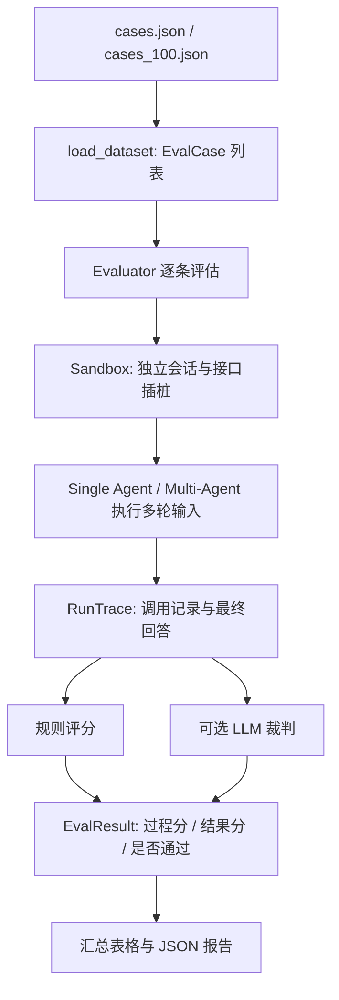

# 第9期：Agent 过程与结果双层评估

本期为客服 Agent 建立可重复运行的评估流程：准备带预期标签的用例，在隔离会话中执行，采集模型和工具调用，再结合代码规则与 LLM-as-judge 生成报告。评估既检查“最终回答是否满足需求”，也检查“为得到回答，路由、工具选择和资源消耗是否合理”。

当前已有 10 条基础用例和 100 条扩展模拟用例。本文按当前代码说明实现与限制，并引用已有的 100 条实测报告，不把平均得分、工具命中率或评分完成率当作业务成功率。

## 1. 为什么要分过程层和结果层

用户问“订单当前是什么状态”，Agent 最终答对了，却先后加载技能、查订单、查物流。回答内容可以满分，但工具调用可能超过完成该请求所需的次数。反过来，调用了正确工具，也不代表回复中的价格、时间和政策一定忠于工具结果。

| 层次 | 关注的问题 | 本项目的指标 |
| --- | --- | --- |
| 过程层 | 是否选对角色、调到所需工具、调用是否高效、消耗是否超预算 | 路由匹配、预期工具命中、调用效率、Token 预算、工具调用过程合理性 |
| 结果层 | 最终意图和转人工判定是否正确、信息是否完整、回答是否可靠 | 意图匹配、关键词覆盖、转人工匹配、回答质量、忠实度 |

两层都采用“可直接计算的用规则，需要语义判断的用模型裁判”的方式。LLM 裁判的分数是辅助评审结论，仍需要结合原始轨迹复核。

## 2. 代码结构与运行流程

| 文件 | 职责 |
| --- | --- |
| [dataset.py](../src/mini_ecom_agent/evaluation/dataset.py) | 定义 `EvalCase`，从 JSON 加载用例 |
| [sandbox.py](../src/mini_ecom_agent/evaluation/sandbox.py) | 创建独立会话、构建 Agent、包装关键接口并执行输入 |
| [trace.py](../src/mini_ecom_agent/evaluation/trace.py) | 定义模型调用、工具返回和整条用例的运行记录 |
| [metrics.py](../src/mini_ecom_agent/evaluation/metrics.py) | 实现规则指标和三个 LLM 裁判函数 |
| [evaluator.py](../src/mini_ecom_agent/evaluation/evaluator.py) | 编排运行、评分、通过判定和报告聚合 |
| [prompts/evaluation.py](../src/mini_ecom_agent/prompts/evaluation.py) | 定义回答质量、忠实度、过程合理性的裁判提示词 |
| [run_eval.py](../src/mini_ecom_agent/scripts/run_eval.py) | 命令行入口，打印结果并导出 JSON |
| [generate_eval_cases_100.py](../src/mini_ecom_agent/scripts/generate_eval_cases_100.py) | 基于固定模拟业务数据生成 100 条用例，不调用模型 |



`Evaluator` 通过 `Sandbox.run()` 获取轨迹，再读取轨迹评分；评分函数无需直接操作 Agent 内部。当前 `run_all()` 顺序执行用例，没有并发评估。

## 3. 如何定义一条评估用例

测试集的顶层格式是 `{"cases": [...]}`。下面是一条可以单独保存为 JSON 的示例；预算和最少调用次数是评测约定，应在比较不同实现前固定下来。

```json
{
  "cases": [
    {
      "id": "order_status_demo",
      "description": "查询已发货订单状态",
      "turns": ["请查一下订单 ORD-20240115-001 的当前状态。"],
      "expected_intent": "ORDER_QUERY",
      "expected_keywords": ["ORD-20240115-001"],
      "expected_requires_human": false,
      "expected_tools": ["query_order"],
      "min_tool_calls": 1,
      "max_tokens": 15000,
      "expected_route": "postsale"
    }
  ]
}
```

| 字段 | 含义及评分范围 |
| --- | --- |
| `id` | 用例标识，也用于沙箱 session 文件名；应唯一且适合作为文件名 |
| `description` | 用例目的，出现在报告中 |
| `turns` | 按顺序送给同一个 Agent 的用户输入；至少一条 |
| `expected_intent` | 最终结构化响应的意图枚举值，例如 `ORDER_QUERY` |
| `expected_keywords` | 最终 `reply` 应包含的字符串，当前使用字面包含判断 |
| `expected_requires_human` | 最终结构化响应是否应标记转人工 |
| `expected_tools` | 整段会话应调用过的工具名，不限制顺序或额外工具 |
| `min_tool_calls` | 完成任务所需的最少调用次数，用于计算效率 |
| `max_tokens` | 整段会话记录到的 Agent Token 预算 |
| `expected_route` | 预期最后一次路由结果：`presale`、`postsale`、`complaint` |

可选标量字段省略或设为 `null` 时，对应规则不评分；关键词和工具列表为空时，也不评分。因此 `expected_tools: []` 本身不表示“禁止调用任何工具”。纯问候用例通过 `min_tool_calls: 0` 检查是否发生了不必要的调用。

多轮示例可以写成：

```json
"turns": [
  "帮我看看之前下的订单。",
  "订单号是 ORD-20240110-003。"
]
```

工具记录和 Token 跨所有轮次累计，但结果指标只评价最后一轮响应。`trace.route` 每次路由都会被覆盖，因此当前只对最后一次路由做标签匹配，尚未对每轮路由分别打分。

`load_dataset()` 直接将 JSON 对象传给 dataclass，并不是完整的输入校验器。字段拼错、用例 ID 重复、空 `turns`、无效标签等问题应在运行前检查；扩展数据集的离线测试承担了一部分检查工作。

## 4. 两套数据集覆盖什么

[cases.json](../src/mini_ecom_agent/evaluation/cases.json) 包含 10 条基础用例，适合快速检查评估链路是否能运行。[cases_100.json](../src/mini_ecom_agent/evaluation/cases_100.json) 是扩展模拟集，分布如下：

| 场景 | 数量 | 主要检查内容 |
| --- | ---: | --- |
| 订单查询 | 15 | 当前状态、下单金额、商品明细 |
| 物流查询 | 15 | 运单、承运商、轨迹，以及待发货无运单场景 |
| 商品咨询 | 18 | 库存、价格、规格和卖点 |
| 政策检索 | 20 | 退换货、配送、会员、FAQ，各 5 条 |
| 退款咨询 | 10 | 查询不同状态订单，解释进度和下一步 |
| 用户订单列表 | 5 | 按已提供的用户名调用 `list_user_orders` |
| 多轮追问 | 7 | 补充订单号、查询后继续追问物流 |
| 投诉升级 | 5 | 投诉路由与转人工判定 |
| 纯问候 | 5 | 正确回复并避免不必要的工具调用 |
| **合计** | **100** | |

扩展集依据项目的 5 个模拟订单、6 个模拟商品和 4 份知识文档编写，不是 100 位真实客户的生产会话。生成器对固定业务状态使用不同问题和追问方式，增加覆盖面，但这些样本并不完全独立。

退款用例要求先核对订单，不预设必须提交 `apply_refund`。这套用例主要验证退款咨询流程，不能证明退款执行全流程已经通过评估。两个数据集的预算和部分预期不同，不能把两次报告通过率的差值直接写成优化收益。

## 5. 沙箱如何隔离和采集

### 5.1 隔离范围

每次创建 `Sandbox` 时生成临时目录，各用例使用独立的 `<case_id>.json` 会话文件，并创建新的 Agent。多轮输入复用该用例的 Agent，以保留会话上下文。

构建 Agent 时，沙箱将 `settings.memory_enabled` 和 `settings.mcp_enabled` 设为 `False`：

- 关闭用户记忆读写，减少已有用户事实对评估的影响。
- 关闭 MCP，统一使用本地工具，避免 MCP 服务可用性干扰当前基线。
- RAG 检索仍按当前配置访问索引和 Embedding API，不会自动替换成固定检索结果。
- Skills 保持当前配置，启用时模型仍可调用 `load_skill`。

这里的沙箱是应用层测试隔离，不是操作系统安全沙箱，也没有实现任意业务写操作的事务回滚。固定数据、独立会话有助于复测，但远程模型、RAG 内容和配置变化仍可能改变结果。

当前实现还有两个使用边界：全局 `settings` 的上述两个开关不会在结束时恢复；同一 `Sandbox` 重复运行相同 ID 会使用相同 session 路径。独立 CLI 运行通常能避开这些问题；在长驻进程或重复实验中应新建沙箱，不要并发共享当前实现。

### 5.2 插桩记录什么

“插桩”是在原方法外包一层记录逻辑，调用仍交给原方法执行。

| 包装位置 | 记录内容 |
| --- | --- |
| `client.chat.completions.create` | 模型名、输入/输出/总 Token、响应请求的工具、耗时、结束原因及适用时的正文 |
| `client.beta.chat.completions.parse` | 结构化响应提取调用，标记为 `extract` |
| `ToolManager.execute_tools` | 已执行并返回的工具名、参数、返回字符串 |
| `Router.router` | 最后选中的专家角色，并把该阶段模型调用标记为 `router` |

普通工具决策调用标记为 `react`，这些标签用于阅读报告，不代表采集了模型内部思维链。`LLMCallRecord.latency_ms` 是模型请求耗时，当前没有单独记录工具执行耗时，也没有自动汇总 P95 延迟。

包装函数在正常返回后记录数据。若接口直接抛出异常，该次调用可能没有 usage 或工具观察记录；此前已记录的 Token 仍计入异常用例消耗。因此报告的 Token 是“已采集的 Agent 调用用量”，不能当作完整账单。

结束时恢复被包装的方法并关闭 ToolManager，刻意不调用 `agent.close()`，避免触发长期记忆巩固。

## 6. 过程指标如何计算

| 指标 | 当前计算口径 | 注意事项 |
| --- | --- | --- |
| `tool_accuracy` | 实际调用过的预期工具数量 / 预期工具数量 | 更准确地说是“预期工具命中比例”；不检查参数正确性、工具成功状态或多余调用 |
| `tool_efficiency` | `min(1, min_tool_calls / actual_calls)` | 所有已记录工具调用都计数，包括 `load_skill` |
| `token_pass` | `total_tokens <= max_tokens` | 未设预算时不评分；只计记录到的 Agent 调用 |
| `route_match` | 预期路由与 `trace.route` 相等为 1，否则为 0 | 不标注预期路由则不评分 |
| `process_soundness` | LLM 根据末轮问题和整段工具名序列打 1～5 分，再除以 5 | 当前裁判不读取每步工具参数与返回值 |

调用效率的边界规则：实际调用为 0、理论最少也为 0 时得 1；实际为 0、理论最少大于 0 时返回 `None`，缺失必要调用由其他维度检查。

例如预期 `query_order`，最少调用 1 次，实际调用：

```text
load_skill → query_order → query_logistics
```

此时 `tool_accuracy = 1`，`tool_efficiency = 1/3`。前者只证明所需工具曾被调用，后者反映当前预算约定下调用次数偏多。额外调用是否确实无用，还需要看用户需求、技能流程和裁判理由，不能机械地把每次技能加载都当成缺陷。

## 7. 结果指标与 LLM-as-judge

| 指标 | 当前计算口径 |
| --- | --- |
| `intent_match` | 最终结构化意图与 `expected_intent` 完全相同为 1 |
| `keyword_coverage` | 在最终 `reply` 中出现的预期关键词数量 / 关键词数量 |
| `requires_human_match` | 最终转人工标记与预期布尔值一致为 1 |
| `answer_quality` | 裁判根据末轮问题、最终回复和参考关键词打 1～5 分，再除以 5 |
| `faithfulness` | 裁判对照整段会话工具返回核查最终回复，忠实为 1，否则为 0 |

关键词检查使用 Python 的 `kw in reply`，并不是语义匹配。同义词可能漏判，包含关键词也不保证事实正确。转人工指标只验证 `requires_human` 字段，不证明实际已接通人工服务。

开启 Judge 时，每条正常运行用例通常额外请求三次裁判：回答质量、忠实度、过程合理性。裁判使用 `temperature=0.0`，要求返回 JSON 和理由；当前 CLI 的裁判与被测 Agent 使用相同的模型配置，裁判调用通过另一个客户端执行，不计入 Agent 轨迹。

当前提示词与解析逻辑的限制也应保留在解读中：

- 回答质量只收到参考关键词，没有完整标准答案；多轮用例也只提供末轮问题。
- 忠实度依据工具返回评判，提示词对纯问候和一般性政策说明留有豁免，不能保证发现所有政策错误。它也没有按来源区分业务工具与技能说明的可信程度。
- 裁判自身可能误判；同一模型担任生成者和裁判也可能有共同偏差。
- 裁判 JSON 解析失败时，函数返回 0 和错误理由。质量与过程分随后会被转为 `None`、跳过均值；忠实度则记 0。这些情况不一定进入 `error_cases`，应检查 `judge_reasons`。
- 分值范围和 `faithful` 类型尚未进行严格结构校验，因此“完成评分”不等于每一项裁判输出都已经人工验证。

## 8. 平均得分、通过率和完成状态的区别

单用例过程分为以下非空项的算术平均：

```text
process_score = mean(tool_accuracy, tool_efficiency,
                     process_soundness, route_match)
```

结果分为以下非空项的算术平均：

```text
result_score = mean(intent_match, keyword_coverage,
                    requires_human_match, answer_quality, faithfulness)
```

Token 预算单独参与通过判断，不进入 `process_score`。报告的两个平均得分再对各用例相应得分求均值，并跳过 `None`。不同用例有不同的已标注维度，所以平均分是综合评分，不是准确率。

当前通过阈值默认 `0.6`。一条用例通过需满足：没有运行或评分异常，未超 Token 预算，所有非空评分维度均达到阈值。不是平均分达到阈值就通过。

报告中的 `order_01` 是一个实际例子：结果分为 100%，但调用效率为 1/3，小于 0.6，最终 `passed=false`。因此整体结果平均分很高、全维度通过率较低，两者可以同时成立。

| 输出 | 准确含义 |
| --- | --- |
| `scored_cases` | `error` 为空的用例数量，不代表全部指标通过或所有裁判格式都有效 |
| `error_cases` | 记录了运行或评分异常的用例数量 |
| `pass_rate` | 通过用例数 / 全部用例数，异常用例也在分母中 |
| `🎉 评估完成` | 没有进入 `error` 字段的异常，不表示 100% 通过 |
| CLI 退出码 0 | 完成运行；即使有质量指标不达标，也可能返回 0 |

出现运行或评分异常时，CLI 会先按要求输出报告，再以退出码 1 结束。若要将质量通过率作为 CI 门槛，需要另外读取报告并判定；当前脚本没有这个门禁。

## 9. 如何实际运行

以下命令均在项目根目录执行。现有虚拟环境可直接使用 `.venv/Scripts/python.exe`；习惯 uv 时也可以加上 `uv run`。

### 9.1 运行前准备

在项目 `.env` 配置有效的 `LLM_API_KEY`、`LLM_BASE_URL`、`LLM_MODEL_NAME`。模型名应填服务支持的模型标识，API 地址应填在 Base URL 字段，不能互换。政策用例还需要有效的 Embedding 配置与已构建的知识库索引。

首次建库，或知识文档、Embedding 模型变更后，执行：

```powershell
uv run python src/mini_ecom_agent/scripts/build_kb_idx.py
```

已有匹配的索引时不必每次评估都重建。知识库细节见 [第5期-RAG检索增强生成](第5期-RAG检索增强生成.md)。当前评估会关闭 MCP，因此不需要启动 MCP 服务。

### 9.2 先运行 10 条基础集

```powershell
uv run python src/mini_ecom_agent/scripts/run_eval.py --mode multi --no-judge --output sessions/eval_rules.json
```

`--no-judge` 只关闭裁判，Agent 自身和知识查询所需的模型 API 仍会调用。“离线评估”指基于固定数据集批量测试，不等于断网运行。

启用完整双层评分：

```powershell
uv run python src/mini_ecom_agent/scripts/run_eval.py --mode multi --judge --output sessions/eval_baseline.json
```

### 9.3 运行 100 条扩展集

仓库已经提供生成好的 JSON。需要按当前生成器重新生成时可执行以下命令；它会覆盖 `cases_100.json`，不会覆盖 10 条基础集：

```powershell
uv run python src/mini_ecom_agent/scripts/generate_eval_cases_100.py
```

正式评估建议使用新报告文件名，保留原始实测基线：

```powershell
uv run python src/mini_ecom_agent/scripts/run_eval.py --mode multi --dataset src/mini_ecom_agent/evaluation/cases_100.json --judge --output sessions/eval_report_100_next.json
```

`--dataset` 与 `--output` 的相对路径都以项目根目录解析。只有传入 `--output` 才会保存 JSON。当前逐条运行，最后统一写报告，没有中途检查点或断点续评功能。

### 9.4 单 Agent 评估与模式比较

使用没有 `expected_route` 标注的基础集，可以直接运行单 Agent：

```powershell
uv run python src/mini_ecom_agent/scripts/run_eval.py --mode single --judge --output sessions/eval_single.json
```

100 条数据集包含多 Agent 路由标签。当前评分器不会在 single 模式自动跳过路由，直接拿这份数据运行 single 会使已标注路由项得 0。比较两种模式时，应另存一份移除 `expected_route` 的共同数据集，在两种模式都使用该副本；多 Agent 的路由匹配另行评价。

同时固定模型、温度、技能开关、知识索引、Token 预算、Judge 设置和评分阈值。否则差异可能来自配置或测试标准，而非 Agent 架构。

## 10. 100 条实测报告怎么读

已有报告为 [sessions/eval_report_100.json](../sessions/eval_report_100.json)，运行日志为 [sessions/eval_report_100.log](../sessions/eval_report_100.log)。报告时间为 2026-10-26，模式 `multi`，模型与裁判为 `deepseek-v4-flash`，开启 Skills 和 Judge，Agent 温度为 0.7，通过阈值为 0.6。这是一次运行的结果。

| 指标 | 实测值 | 解读 |
| --- | ---: | --- |
| 全部用例 | 100 | 固定模拟客服用例 |
| 完成评分 / 异常 | 100 / 0 | `error` 字段均为空 |
| 全维度通过 | 49 / 100（49%） | 所有已评分维度及 Token 预算共同判定 |
| 平均过程得分 | 91.2% | 多个过程维度的平均值 |
| 平均结果得分 | 92.5% | 多个结果维度的平均值 |
| 已标注路由匹配 | 89 / 89 | 其余 11 条未标注路由 |
| 预期工具全部命中的用例 | 90 / 90 | 其余 10 条未设置预期工具列表；不代表工具参数全部正确 |
| Agent Token 总量 | 687,048 | 不含 Judge 与 Embedding |
| 平均 Agent Token / 用例 | 6,870.48 | 包含用例各轮记录到的 Agent 调用 |

本次核对时，报告的 `dataset_sha256` 与仓库中 `cases_100.json` 一致：

```text
4cad3b20405dfbabb5135a7b9ae6e2ad60ad93c450f2a789772f63cea8c9953c
```

按当前 0.6 阈值统计，未达标维度包括：调用效率 33 条、忠实度 14 条、意图匹配 5 条、过程合理性 4 条、转人工匹配 2 条、关键词覆盖 1 条、回答质量 1 条。同一用例可以同时未通过多个维度，不能将这些数量直接相加作为失败用例总数。

这份报告说明当前路由和必要工具覆盖较好，但额外调用及回答依据仍有改进空间。尤其 `load_skill` 被计入调用次数，而多数用例的 `min_tool_calls` 只计算最少业务调用；应先区分有益的流程加载和实际冗余，再决定优化代码还是修订评估口径。调整口径后应保留旧报告、说明变更，重新建立基线。

## 11. JSON 报告与问题定位

报告顶层结构为：

```text
metadata
  模型、模式、温度、技能开关、数据集哈希、阈值、Token 统计范围等
summary
  总数、通过数、异常数、平均得分、Token 汇总
cases[]
  case_id / description / passed / error
  process          过程指标及过程分
  result           结果指标及结果分
  judge_reasons    三个裁判给出的理由
  trace            最终回答、路由、工具输入输出、逐次模型调用
```

PowerShell 中可以快速查看摘要和未通过用例：

```powershell
$evalReport = Get-Content -Raw -Encoding utf8 sessions/eval_report_100.json | ConvertFrom-Json
$evalReport.summary
$evalReport.cases | Where-Object { -not $_.passed } | Select-Object case_id, error, process, result
```

排查时先看 `error`；没有异常再看低分维度，最后对照 `judge_reasons` 和 `trace.tool_observations`。`trace.llm_calls` 中的 `finish_reason`、正文及用途标签有助于判断空输出、截断和路由问题。控制台表格没有显示全部字段，例如 `route_match` 要在 JSON 中查看。

| 现象 | 建议检查 |
| --- | --- |
| `Router` 方法找不到 | 插桩是否对接实际的 `Router.router`，而非不存在的 `route` |
| 所有用例都路由到售后 | 路由输出是否为空或截断；检查模型返回和 `router_max_tokens` |
| `CustomerServiceResponse` 校验失败 | 结构化字段类型，尤其追问列表与字符串的兼容处理 |
| 工具命中高、通过率低 | 调用效率、Token 预算、忠实度，以及当前技能调用的计数口径 |
| 政策问答失败 | 索引是否存在、Embedding 模型是否一致、检索工具是否返回错误 |
| 平均分看起来高，但有异常 | 均值跳过了未评分项，必须同时查看异常数与通过率 |

## 12. 已有离线验证与后续完善

相关测试可以在不请求真实模型 API 的情况下运行：

```powershell
.venv/Scripts/python.exe -m unittest discover -s tests -p "test_eval_*.py" -v
```

当前三个文件包含 11 项测试：

- [test_eval_sandbox.py](../tests/test_eval_sandbox.py)：模拟客户端验证单／多 Agent 轨迹采集、规则评分及意图标签。
- [test_eval_failures.py](../tests/test_eval_failures.py)：验证路由截断重试、空输出报错、追问格式兼容、异常 Token 统计和报告路径。
- [test_eval_dataset_100.py](../tests/test_eval_dataset_100.py)：检查 100 条数据数量与唯一性、生成器一致性、工具标签和模拟订单引用。

这些测试验证评估代码的行为，不替代真实模型的质量测试。当前尚未实现的能力包括：

| 方向 | 需要补充的工作 |
| --- | --- |
| 更完整的工具评估 | 参数断言、禁止调用检查、工具成功状态、顺序依赖和业务后置条件 |
| 多轮评估 | 保存各轮最终响应与路由，逐轮评分，裁判读取完整对话 |
| 裁判可靠性 | 严格解析与范围检查、重试、解析失败单独计数、抽样人工复核 |
| 实验可复现性 | 保存代码版本、Prompt/Skill/知识库版本，多次运行观察波动 |
| 成本与性能 | 计入 Judge、Embedding，采集工具耗时并汇总延迟分布 |
| MCP、Memory 专项 | 独立测试工具发现与调用、跨会话记忆读写；当前沙箱关闭了它们 |
| 检索质量专项 | 建立问题到相关文档片段的人工核验标签，计算 Hit@K、MRR 等 |

现有 100 条数据是带预期标签的 Agent 回归集，还没有检索相关片段标注，不能称为已完成的检索 Golden Set。RAG 当前使用向量 Top-K，没有混合检索和 Rerank。已实现的 LLM-as-judge 评价的是工具调用过程与最终回答，也不能替代检索排名指标。

## 13. 对外介绍时的准确表述

> **过程与结果双层评估：**构建 100 条模拟客服用例，通过独立会话与运行时插桩采集路由、工具输入输出、模型调用耗时和 Token；结合规则与 LLM-as-judge 评估执行效率、回答质量及忠实度，支持单／多 Agent 运行及 JSON 报告导出。实测 100 条均完成评分，全维度通过 49 条，并据此定位工具冗余调用和回答依据不足的问题。

如引用 89/89 路由匹配或 90/90 预期工具命中，应同时写明各自分母及含义；91.2% 和 92.5% 是平均评分，不应改写为准确率、任务成功率或线上解决率。
